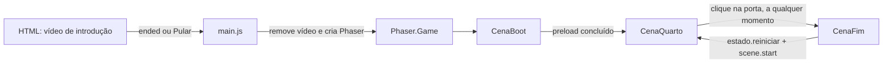

# O Quarto do Beenie — como a demo foi feita

**Versão:** protótipo isolado em Phaser · **Atualizado em:** 2026-11-17

- URL local: `/demo/quarto-beenie/`
- URL de inspeção: `/demo/quarto-beenie/?teste=1`
- Documento operacional: [`src/public/demo/quarto-beenie/README.md`](../src/public/demo/quarto-beenie/README.md)

Este documento explica a implementação da demo **O Quarto do Beenie**, feita
como um protótipo isolado para validar a sensação de explorar o quarto em
primeira pessoa. O estilo é inspirado em *Cube Escape*: câmera fixa, cenário
desenhado, quatro ângulos, objetos que reagem ao clique e mudanças visuais no
ambiente.

O escopo é menor que o de um escape room completo. **Não há inventário com
vários espaços, combinação de itens, save ou integração com o servidor.** A demo
tem seis atividades e uma regra simples: o jogador carrega **um item por vez** e
pode sair pela porta quando quiser. O resultado final varia conforme o que foi
arrumado. Nada é creditado no Beever.

---

## 1. Como abrir

A demo é estática e não precisa de build. O script é um módulo ES carregado
diretamente pelo navegador.

Opção 1 — servidor estático simples:

```bash
python3 -m http.server 3410 --directory src/public
```

Depois abra:

```text
http://localhost:3410/demo/quarto-beenie/
```

Opção 2 — servidor do projeto:

```bash
npm run dev
```

Depois abra:

```text
http://localhost:3000/demo/quarto-beenie/
```

O app serve `src/public` como raiz de arquivos estáticos em `src/app.js`. A demo
não tem rota própria e não é linkada pelo restante do jogo; ela só existe em
`src/public/demo/quarto-beenie/`.

---

## 2. O que o jogador vê

1. **Introdução em vídeo** — um vídeo curto, com áudio, com poster, botão de
   pular e fallback para autoplay bloqueado. Em `prefers-reduced-motion`, o
   vídeo não começa sozinho.
2. **Boot** — o Phaser só é criado depois do vídeo. A cena de boot carrega os
   retratos do Beenie, a moeda, as quatro paredes, os overlays de itens e os
   ícones de `img/jogo/icones/`.
3. **Quarto** — quatro paredes navegáveis: Frente, Direita, Trás e Esquerda.
   Cada parede é um PNG 600 × 600 que ocupa o palco inteiro, com uma dica, um
   título e hotspots clicáveis. Um hexágono escuro preso ao canto superior
   esquerdo mostra o ícone do item na mão.
4. **Atividades** — seis tarefas de pegar e guardar. O baú e o armário começam
   abertos; a cama começa vazia; o quadro, torto; a cortina, fechada; o livro,
   fora da mesa.
5. **Fim** — ao sair pela porta, a cena mostra o que foi concluído, o que ficou
   pendente e o mel fictício proporcional, com botão para jogar de novo sem
   passar pelo vídeo outra vez.

### 2.1 As seis atividades

| Parede | Atividade | Como conclui |
|---|---|---|
| Direita | Cama | Pegar os dois travesseiros (um na Frente e outro na Direita) e a coberta, um de cada vez, clicando na cama após cada item. |
| Direita | Quadro | Clicar no quadro torto para endireitá-lo. |
| Esquerda | Baú | Pegar os brinquedos e clicar no baú. O baú começa aberto e termina fechado. Os fiapos são decoração; o dos brinquedos some ao pegá-los. |
| Esquerda | Armário | Pegar as três roupas espalhadas pela Frente, Trás e Esquerda e clicar no armário. O armário começa aberto e termina fechado. |
| Trás | Mesa | Pegar o livro e clicar na mesa. |
| Trás | Janela | Clicar na cortina fechada para abri-la. O contorno de hover pertence à cortina, não à janela. |

A parede da Frente tem a porta de saída, uma roupa e um travesseiro no chão. A
porta não é uma atividade: fica sempre disponível e encerra a visita quando o
jogador quiser, mesmo com um item na mão. A parede de Trás também tem uma roupa
espalhada.

O total possível é **39 de mel (demo)**: 8 do baú, 8 do armário, 8 da cama, 4 do
quadro, 6 da mesa e 5 da janela. O jogador pode sair com 0, com parte ou com
todos esses valores; não há bônus obrigatório por completar as seis atividades.
O valor é local e serve só para o protótipo.

---

## 3. Onde estão os arquivos

```text
src/public/demo/quarto-beenie/          # o que o navegador baixa
├── index.html                          # página, vídeo, palco, status e painel
├── demo.css                            # estilo isolado, responsivo e reduced-motion
├── intro.mp4                           # introdução placeholder
├── intro.webm                          # mesma introdução em WebM
├── poster.png                          # poster do vídeo (1280×720)
└── README.md                           # manual curto da demo

src/public/js/demo/quarto-beenie/       # lógica da demo
├── main.js                             # entrada: vídeo → Phaser
├── cenas/
│   ├── CenaBoot.js                     # retratos, moeda, paredes, itens e ícones
│   ├── CenaQuarto.js                   # rotação, HUD, hotspots e hexágono da mão
│   ├── CenaFim.js                      # resumo e reinício
│   └── CenaMinigame.js                 # legado: não é carregada pelo main.js
├── dadosDoQuarto.js                    # imagens, ícones, paredes, hotspots, textos e recompensas
├── desenho.js                          # composição das paredes em camadas
├── estadoDoJogo.js                     # estado compartilhado + EventEmitter
└── interface.js                        # ponte para #status e #instrucoes

src/public/img/jogo/                    # arte do quarto, com prefixo da parede
src/public/img/jogo/icones/             # ícones do item carregado
src/public/js/vendor/demo/
└── phaser.esm.min.js                   # Phaser 3.90 auto-hospedado
```

| Arquivo | Papel |
|---|---|
| [`index.html`](../src/public/demo/quarto-beenie/index.html) | Estrutura da página, camada de vídeo, contêiner do canvas, `#status`, `#instrucoes` e painel que explica a arquitetura. |
| [`demo.css`](../src/public/demo/quarto-beenie/demo.css) | Estilo da demo. Fica fora do bundle do app e inclui os breakpoints de 760 px e 560 px. |
| [`main.js`](../src/public/js/demo/quarto-beenie/main.js) | Faz o handoff do vídeo para o Phaser, configura o jogo e liga os botões da página. |
| [`CenaBoot.js`](../src/public/js/demo/quarto-beenie/cenas/CenaBoot.js) | Preload de `beenie-default`, `beenie-feliz`, `beenie-uou`, `beenie-estrelas`, `moeda`, `IMAGENS_DO_QUARTO` e `ICONES_DOS_ITENS`. |
| [`CenaQuarto.js`](../src/public/js/demo/quarto-beenie/cenas/CenaQuarto.js) | Orquestra as paredes, o HUD, os hotspots, o diálogo e o hexágono do item na mão. Não desenha o cenário sozinha. |
| [`CenaFim.js`](../src/public/js/demo/quarto-beenie/cenas/CenaFim.js) | Mostra o resumo proporcional e reinicia o estado local. |
| [`dadosDoQuarto.js`](../src/public/js/demo/quarto-beenie/dadosDoQuarto.js) | Fonte da verdade para imagens, ícones, paredes, coordenadas, camadas, rótulos, mensagens e moedas. |
| [`desenho.js`](../src/public/js/demo/quarto-beenie/desenho.js) | Compõe a parede PNG 600 × 600 com as camadas condicionais de itens e desenha a moldura. |
| [`estadoDoJogo.js`](../src/public/js/demo/quarto-beenie/estadoDoJogo.js) | Objeto único com parede atual, atividades, itens guardados, item na mão e mel fictício. |
| [`interface.js`](../src/public/js/demo/quarto-beenie/interface.js) | Publica mensagens acessíveis na página e detecta `prefers-reduced-motion`. |

O Phaser fica em `src/public/js/vendor/demo/` para respeitar a CSP
`scriptSrc 'self'` de `src/app.js`: não há CDN, script inline nem dependência
externa em tempo de execução.

O carregador de imagens usa `loader.imageLoadType: 'HTMLImageElement'` em
[`main.js`](../src/public/js/demo/quarto-beenie/main.js). O padrão do Phaser
baixa cada PNG por XHR e o entrega à tag `` como uma URL `blob:`, que a
CSP `img-src 'self' data:` bloqueia. Com o carregamento direto, as imagens
continuam vindo de `/img/jogo/` sem afrouxar a política.

### 3.1 Mapa das imagens

Os arquivos em `src/public/img/jogo/` mantêm o prefixo original da arte. Depois
da inversão dos lados, a arte `D_*` (armário e baú) aparece na parede Esquerda,
e a arte `E_*` (cama e quadro) aparece na parede Direita.

- **Frente (F):** `F_parede.png`, `F_porta.png`, `F_roupa.png`,
  `F_travesseiro.png`.
- **Trás (T):** `T_parede.png`, `T_janela.png`, `T_cortina_fechada.png`,
  `T_cortina_aberta.png`, `T_mesa.png`, `T_livro_jogado.png`,
  `T_livro_fechado.png`, `T_roupa.png`.
- **Direita — arte E:** `E_parede.png`, `E_cama_vazia.png`,
  `E_travesseiro.png`, `E_travesseiro1_arrumado.png`,
  `E_travesseiro2_arrumado.png`, `E_coberta.png`, `E_coberta_arrumada.png`,
  `E_quadro_torto.png`, `E_quadro.png`, `E_fiapo_cama.png`,
  `E_fiapo_travesseiro.png`.
- **Esquerda — arte D:** `D_parede.png`, `D_armario_aberto.png`,
  `D_armario_fechado.png`, `D_roupa.png`, `D_bau_aberto.png`,
  `D_bau_fechado.png`, `D_brinquedos.png`, `D_fiapo_bau.png`,
  `D_fiapo_brinquedos.png`.
- **Ícones da mão:** `icones/brinquedos_icon.png`, `icones/coberta_icon.png`,
  `icones/livro_icon.png`, `icones/travesseiro1_icon.png`,
  `icones/travesseiro2_icon.png`, `icones/F_roupa_icon.png`,
  `icones/T_roupa_icon.png` e `icones/D_roupa_icon.png`. O registro
  `ICONES_DOS_ITENS` associa cada ícone a um `IDS_DOS_ITENS`. Quadro e cortina
  são atividades de clique, não itens carregáveis, e não têm ícone.

As roupas estão espalhadas por três paredes: `F_roupa.png` na Frente,
`T_roupa.png` em Trás e `D_roupa.png` na Esquerda. Os travesseiros são dois:
`F_travesseiro.png` na Frente e `E_travesseiro.png` na Direita. As imagens
`*_fiapo_*.png` são decoração sobre os objetos: entram como camadas sem hotspot,
não fazem parte de `IDS_DOS_ITENS` e ficam logo depois do objeto correspondente.
Os fiapos de brinquedos e de travesseiro somem quando o item é pego; os de baú e
cama permanecem.

Os retratos do Beenie ficam em `src/public/img/clicks/` e a moeda em
`src/public/img/mel-moeda-virtual.png`.

---

## 4. Arquitetura em uma figura



A separação principal é:

- **HTML/camada de página:** vídeo, poster, status e instruções.
- **Phaser:** boot, quarto e fim.
- **Estado compartilhado:** um `EventEmitter` pequeno, sem framework.
- **Dados:** paredes, camadas e hotspots fora da cena, para trocar conteúdo sem
  reescrever a lógica de interação.

---

## 5. O vídeo antes do Phaser

O vídeo é HTML de propósito. Fora do canvas, autoplay, poster, botão de pular e
`prefers-reduced-motion` ficam previsíveis. O canvas só é criado quando o vídeo
termina ou é pulado.

O elemento `<video>` não usa `muted`: os arquivos `intro.mp4`/`intro.webm`
têm faixa de áudio. `main.js` tenta o autoplay com som e, se o navegador
bloquear, mostra “Reproduzir com áudio”; o clique do usuário autoriza a mesma
chamada `play()`. Sem isso, o autoplay silencioso do início do protótipo
descartava o áudio do vídeo definitivo.

`main.js` remove a camada de vídeo, espera a animação de saída e então cria o
jogo:

```js
const jogo = new Phaser.Game({
  type: Phaser.AUTO,
  parent: 'jogo',
  width: LARGURA,
  height: ALTURA,
  backgroundColor: '#1b1508',
  scene: [CenaBoot, CenaQuarto, CenaFim],
  scale: {
    mode: Phaser.Scale.FIT,
    autoCenter: Phaser.Scale.CENTER_BOTH,
  },
});
```

O canvas recebe `aria-label`, `role="application"` e `tabindex="0"` para que o
teclado e os leitores de tela tenham um ponto de entrada.

---

## 6. Dados: paredes, camadas e hotspots

[`dadosDoQuarto.js`](../src/public/js/demo/quarto-beenie/dadosDoQuarto.js) é a
fonte da verdade. A cena não sabe o que é uma cama ou um baú; ela interpreta o
tipo do hotspot e consulta o estado.

### 6.1 Uma parede

```js
{
  id: 'direita',
  nome: 'Direita',
  titulo: 'Cama e quadro',
  dica: 'A cama está vazia e o quadro está torto…',
  fundo: 'parede-direita',
  visuais: [ /* camadas desenhadas na ordem */ ],
  hotspots: [ /* áreas clicáveis */ ],
}
```

A ordem do array `PAREDES` é a ordem da rotação:
Frente → Direita → Trás → Esquerda → Frente.

### 6.2 Camadas condicionais

Cada parede tem uma lista `visuais`. Cada visual é um PNG 600 × 600 desenhado
sobre o fundo. A condição `quando` decide se ele aparece:

- `item-nao-colocado`: o item ainda está no cenário e não está na mão;
- `item-colocado`: o item já foi guardado no móvel;
- `tarefa-aberta`: a atividade ainda não foi concluída;
- `tarefa-concluida`: a atividade já foi concluída.

Exemplo da cama, com dois travesseiros e a coberta:

```js
visuais: [
  { id: 'cama', imagem: 'item-cama' },
  { id: 'coberta', imagem: 'item-coberta', quando: 'item-nao-colocado', item: 'coberta' },
  { id: 'coberta-arrumada', imagem: 'item-coberta-arrumada', quando: 'item-colocado', item: 'coberta' },
  { id: 'travesseiro-direita', imagem: 'item-travesseiro-2', quando: 'item-nao-colocado', item: 'travesseiro-direita' },
  { id: 'travesseiro-arrumado-1', imagem: 'item-travesseiro-arrumado-1', quando: 'item-colocado', item: 'travesseiro-direita' },
  { id: 'travesseiro-arrumado-2', imagem: 'item-travesseiro-arrumado-2', quando: 'item-colocado', item: 'travesseiro-frente' },
],
```

Isso permite trocar a cama vazia pela cama com dois travesseiros e coberta sem
duplicar a lógica na cena. O contorno de hover usa o `id` da camada indicada no
hotspot (`visual`). Camadas com `decorativo: true` ficam fora do mapa de itens e
não geram contorno; é o caso dos fiapos. Eles entram logo depois do objeto
correspondente para ficarem por cima dele. Os fiapos de brinquedos e de
travesseiro usam `item-nao-colocado` e somem quando o item é pego; os de baú e
cama permanecem.

### 6.3 Hotspots

Cada hotspot tem:

- `id`, `rotulo`, `x`, `y`, `w`, `h`;
- `tipo`: `inspecao`, `pegar`, `guardar` ou `tarefa`;
- `item` quando for `pegar`;
- `aceita` e `completaCom` quando for `guardar`;
- `tarefa` quando concluir uma atividade;
- `visual` para ligar o hotspot à camada do hover;
- `emocao` e `mensagem` para o diálogo.

Os quatro tipos são:

- `inspecao`: só mostra uma mensagem, sem alterar o estado;
- `pegar`: coloca um item na mão. Se a mão já estiver ocupada, a cena explica e
  não troca o item;
- `guardar`: tenta colocar o item da mão no móvel. O móvel declara quais itens
  aceita e quais precisa para concluir a atividade;
- `tarefa`: conclui direto, como abrir a cortina ou endireitar o quadro.

A ordem dos hotspots no array importa: o alvo do móvel vem antes do item que
está sobre ele. Assim, o item recebe o clique primeiro e o móvel fica acessível
depois que o item sai do cenário.

---

## 7. Estado compartilhado

[`estadoDoJogo.js`](../src/public/js/demo/quarto-beenie/estadoDoJogo.js) é um
singleton que estende `Phaser.Events.EventEmitter`:

```js
export const IDS_DAS_TAREFAS = Object.freeze([
  'bau', 'armario', 'cama', 'quadro', 'mesa', 'janela',
]);

export const IDS_DOS_ITENS = Object.freeze([
  'brinquedos',
  'roupa-frente',
  'roupa-tras',
  'roupa-esquerda',
  'travesseiro-frente',
  'travesseiro-direita',
  'coberta',
  'livro',
]);

class EstadoDoJogo extends Phaser.Events.EventEmitter {
  constructor() {
    super();
    this.moedas = 0;
    this.parede = 0;
    this.tarefas = criarTarefas();
    this.itens = criarItens();
    this.carregando = null;
  }
}
```

### 7.1 A regra de um item por vez

`pegar(item)` devolve um resultado em vez de lançar exceção:

```js
pegar(item) {
  if (this.itens[item]) return { ok: false, motivo: 'ja-colocado' };
  if (this.carregando === item) return { ok: false, motivo: 'ja-na-mao' };
  if (this.carregando) {
    return { ok: false, motivo: 'maos-ocupadas', carregando: this.carregando };
  }

  this.carregando = item;
  this.emit('mudou', this);
  return { ok: true, item };
}
```

`guardarEm(aceitos)` só limpa `carregando` e marca `itens[item] = true` quando o
móvel aceita aquele item. Se o item estiver errado, ele continua na mão e a cena
mostra a dica.

`concluirTarefa(id, recompensa)` é idempotente: clicar duas vezes na mesma
atividade não soma mel duas vezes.

### 7.2 Eventos

A cena do quarto assina `mudou` e `completo` no `create()` e remove tudo no
`shutdown`, junto com o container da parede:

```js
estado.on('mudou', this.estadoListener);
estado.on('completo', this.completoListener);

this.events.once('shutdown', () => {
  estado.off('mudou', this.estadoListener);
  estado.off('completo', this.completoListener);
  destruirContainer(this.paredeAtual);
});
```

A cena reage a `mudou` para atualizar só o ícone do item na mão. Quando a última
atividade termina, `completo` apenas troca o diálogo para avisar que tudo está
pronto e que a porta está disponível. A ida para `CenaFim` acontece somente
quando o jogador clica na porta.

**Limite importante:** `estado` é local e o cliente é a autoridade. Em uma
integração real, o servidor deve calcular e creditar a recompensa; o cliente não
pode decidir quanto mel o jogador ganhou.

---

## 8. Rotação e HUD

A rotação é uma conta modular em `CenaQuarto.js`:

```js
girar(direcao) {
  if (this.emTransicao || this.indoParaFim) return;
  const proximo = (estado.parede + direcao + TOTAL_DE_PAREDES) % TOTAL_DE_PAREDES;
  this.mostrarParede(proximo, direcao);
}
```

`direcao` é `1` para a direita e `-1` para a esquerda. O `+ TOTAL_DE_PAREDES`
antes do módulo garante que `-1` continue no intervalo 0–3.

`mostrarParede()` cria um container novo fora da tela, desenha a parede e os
hotspots, anima a entrada e destrói o container anterior. A troca pode ser
imediata (`imediato = true`) para o create e os testes.

O cabeçalho fica em HTML, acima do palco, para o PNG 600 × 600 não ser coberto.
Ele contém apenas o título **Quarto do Beenie**, centralizado: sem direção, sem
contador de tarefas, sem mel e sem favos de progresso. O diálogo do Beenie fica
na parte de baixo do canvas, e o item carregado aparece somente no hexágono
dentro do canvas.

Além do HUD HTML, `CenaQuarto` desenha um elemento persistente no canvas: o
hexágono da mão com `depth = 60`, acima das paredes (`depth = 10`) e abaixo do
painel de diálogo (`depth = 100`). O centro fica em `(42, 42)` e o raio `76`
ultrapassa as bordas superior e esquerda. O canvas recorta o favo, deixando
visíveis principalmente os lados internos, como se ele nascesse da moldura do
jogo. O ícone do item carregado fica no centro do hexágono. Ele fica vazio
quando `estado.carregando` é `null` e recebe o ícone de `ICONES_DOS_ITENS`
quando um item é pego. Como o elemento não pertence ao container da parede,
sobrevive à rotação; como não é interativo, não bloqueia os hotspots.

As setas laterais são chevrons desenhados como vetor, com os pontos simétricos
em torno de `(0, 0)`, dentro do círculo de 48 px. O glifo da fonte foi
abandonado porque suas larguras laterais diferentes deslocavam a ponta mesmo
com `setOrigin(0.5)`.

O `#status` publica uma mensagem equivalente à do diálogo em `role="status"`
com `aria-live="polite"`, para leitores de tela e para quem está jogando no
celular. Os hotspots não têm mais marcadores piscando: o rótulo e o contorno
aparecem só no hover.

---

## 9. Fluxo de uma atividade

1. O jogador clica em um hotspot `pegar`. A cena chama `estado.pegar(item)`.
2. Se a mão está livre, o item some do cenário e seu ícone aparece no hexágono
   do canto superior esquerdo.
3. O jogador navega até o móvel e clica no hotspot `guardar`.
4. A cena chama `estado.guardarEm(aceita)`.
5. Se o item é aceito, ele é marcado como colocado. Se todos os requisitos de
   `completaCom` estão satisfeitos, a cena chama `estado.concluirTarefa()`.
6. A parede é redesenhada com as camadas novas: baú fechado, armário fechado,
   cama arrumada, livro na mesa, cortina aberta ou quadro reto.
7. Quando a última atividade termina, o estado emite `completo` e a cena avisa
   que tudo está pronto. O jogador ainda precisa clicar na porta para sair.
8. Ao clicar na porta, `CenaFim` soma o mel das atividades concluídas e mostra
   as listas de concluídas e pendentes. Sair sem fazer nada, sair no meio ou
   terminar tudo são resultados válidos.

---

## 10. Teste manual

1. Abra `/demo/quarto-beenie/`.
2. Deixe o vídeo terminar ou clique em “Pular introdução”.
3. Gire as quatro paredes com `←`/`→` ou com os botões laterais. O hexágono
   escuro preso ao canto superior esquerdo deve começar vazio e continuar no
   lugar nas quatro paredes.
4. Na parede Direita, pegue os dois travesseiros (um na Frente e outro na
   Direita) e a coberta, clicando na cama após cada item; clique no quadro para
   endireitar.
5. Na parede Esquerda, pegue os brinquedos, clique no baú, pegue a roupa da
   Esquerda e clique no armário.
6. Na parede Frente, pegue a roupa da Frente e o travesseiro da Frente, um de
   cada vez, e guarde no armário/cama.
7. Na parede Trás, pegue a roupa de trás e guarde no armário, clique na
   cortina, pegue o livro e clique na mesa.
8. Confira os fiapos: o do baú e o da cama permanecem; o dos brinquedos some ao
   pegar os brinquedos e o do travesseiro some ao pegar o travesseiro da
   Direita. Nenhum deles responde ao clique.
9. Ao pegar um item, confira que o ícone dele aparece no hexágono; ao guardar, o
   hexágono volta a ficar vazio. Tente pegar um segundo item antes de guardar o
   primeiro: a demo deve recusar, explicar que só cabe um item por vez e manter
   o ícone do primeiro item.
10. Clique na porta logo no começo: o resultado deve mostrar “Você saiu do
    quarto”, 0 mel e 0/6 atividades.
11. Use “Jogar de novo”, conclua parte das atividades e clique na porta: o
    resultado deve mostrar “Quarto parcialmente arrumado!”, o mel apenas das
    concluídas e as listas de concluídas/pendentes.
12. Repita concluindo tudo e clique na porta: “Quarto arrumado!”, 39 mel e 6/6.

Para inspecionar o estado no console, abra `?teste=1`. O objeto exposto é
`globalThis.__beeverDemoQuarto = { jogo, estado }`.

---

## 11. Decisões e limites

- As imagens têm 600 × 600 e o palco tem 600 × 600. A arte ocupa a tela inteira.
- O hexágono do item na mão vive fora das paredes e é recortado pelas bordas do
  canvas, com o ícone no centro. A relação item → ícone fica em
  `ICONES_DOS_ITENS`; quadro e cortina não têm ícone porque são ações de clique,
  não itens carregáveis.
- O cenário é composto por camadas declarativas, não por uma lista de sprites
  mantida à mão. Camadas `decorativo` (fiapos) são desenho puro, sem estado e sem
  hotspot; ficam por cima do objeto correspondente e as condicionais somem com o
  item.
- O baú e o armário começam abertos e terminam fechados. A janela começa com a
  cortina fechada; o quadro começa torto. Nada disso precisa de minigame.
- A porta é o único caminho para `CenaFim`. Ela fica disponível desde o início,
  inclusive com item na mão, e o mel final é a soma das atividades concluídas.
  Não há bônus por completar tudo: o jogador escolhe quando sair.
- `CenaMinigame.js` é legado do protótipo anterior e não é registrada em
  `main.js`.
- As recompensas são apenas locais. Em uma integração real, o servidor deve
  calcular e creditar a recompensa.
- Se a arte mudar de tamanho, atualize `ARTE`, os hotspots e os visuais. Se
  mudar só de conteúdo, mantenha as dimensões e o alinhamento.
